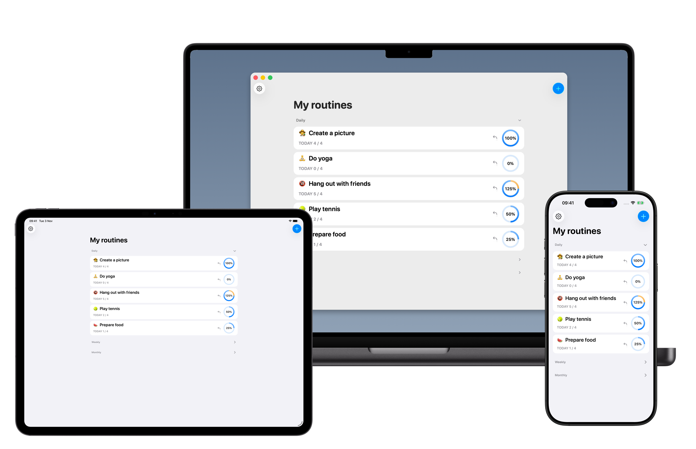

# Routine

A native habit tracker for iPhone, iPad and Mac, with daily, weekly and monthly goals.

[Website](https://routine.dimasike.com) · [Support](https://routine.dimasike.com/support.html) · [Privacy](https://routine.dimasike.com/privacy.html)

- 🎯 Daily, weekly or monthly goals.
- 📈 Progress history, calendars and charts.
- 🔔 Local reminders on your schedule.
- ☁️ Store data locally or use supported iCloud sync.
- 🔐 Face ID, Touch ID or passcode protection.
- 💙 Free and open source, with unlimited routines and no ads or analytics.

> The free 1.1.0 update is not released yet. Routine is currently unavailable on the App Store.

## Our story 👋

We started building Routine in June 2021 to make building habits feel simple.
We published it on the App Store, but life got busy and we couldn’t give it the time it deserved.

Now we’re bringing Routine back, completely free. Every feature is included, with no subscriptions or purchases. 🌱

Created by [Dima](https://x.com/dimasike_) and [Misha](https://x.com/mikemikovich24).

## Development

Routine is in maintenance mode, focused on fixes, compatibility and security.
See [Contributing](CONTRIBUTING.md) for setup and contribution guidelines, or [report a bug](https://github.com/DimaMishchenko/Routine/issues).

[Architecture](ARCHITECTURE.md) · [Testing](TESTING.md) · [Security](SECURITY.md) · [MIT license](LICENSE)
