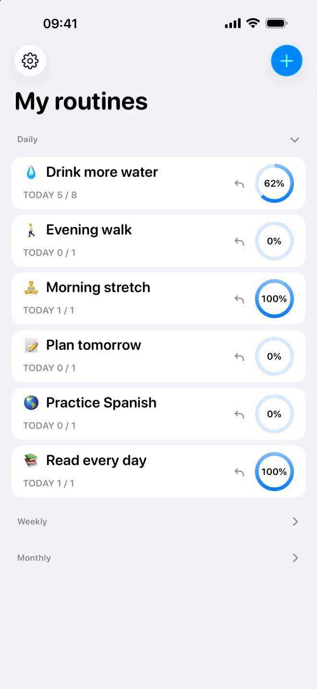
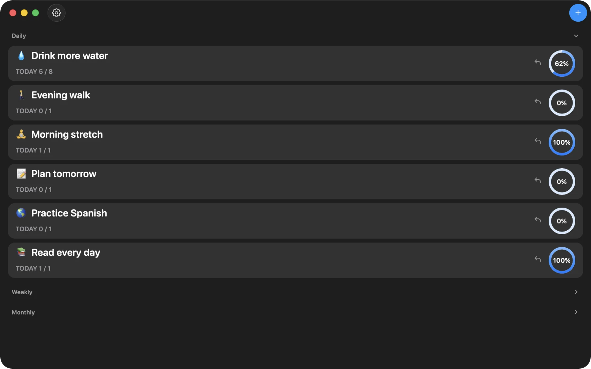

# Routine

A native habit tracker for iPhone, iPad and Mac. Set daily, weekly or monthly goals,
record your progress and make room for the routines that matter to you.

**Fully free. Unlimited routines. No subscription, purchases or app account.**
All features in this source version are available to everyone, including local
reminders, progress history, appearance settings and app protection.

> **Release status:** the free 1.1.0 update is being prepared and has not shipped
> yet. Routine is currently unavailable on the App Store. The previously released
> version, 1.0.4, may have different features, purchases and privacy behavior.

<p>
  
  
</p>

*Native app previews with fictional sample routines.*

## A little progress, every day

- **Your routines, your pace.** Choose a goal and a daily, weekly or monthly schedule;
  personalize routines with an emoji and description.
- **See what adds up.** Track completed goals and explore your history in the calendar
  and progress charts.
- **A gentle reminder.** Schedule optional local notifications on your device.
- **Keep it personal.** Protect the app with Face ID, Touch ID or your device passcode.
- **At home on your devices.** Use the native iPhone and iPad interface or the Mac
  Catalyst app, with light and dark appearance.
- **Your data stays yours.** Store routines locally; official signed builds also
  support sync through your own iCloud account. There is no separate Routine account.

The upcoming version contains no Firebase, RevenueCat, advertising trackers or
purchase system. Read [Privacy](PRIVACY.md) for storage, iCloud and permission details.

## Maintenance mode

**Routine is in maintenance mode.** Work focuses on bug fixes, compatibility with
supported Apple platforms and security issues. Major new features are not actively
planned, and support or contribution reviews may take time; there is no guaranteed
response or release schedule.

For help, email [dimasike.dev@gmail.com](mailto:dimasike.dev@gmail.com).
Report sensitive vulnerabilities privately as described in [Security](SECURITY.md).
See [Contributing](CONTRIBUTING.md) before preparing a change.

## Build locally

Use macOS with **Xcode 27.1**, an iOS Simulator runtime and **Tuist 4.209.0**
(pinned in `mise.toml`). This version targets **iOS/iPadOS 26+** and **macOS 26+**
through Mac Catalyst. Install [mise](https://mise.jdx.dev/) and
[xcbeautify](https://github.com/cpisciotta/xcbeautify), then run:

```sh
mise install
mise exec -- make build
open Routine.xcworkspace
```

`make build` generates the workspace before building. Select **RoutineApp Local**
in Xcode and choose an iOS Simulator. This scheme uses a separate bundle ID and
local Core Data storage. You can build it without an Apple account, developer team,
CloudKit entitlements or service credentials. Dependencies are pinned in the
manifests and `.package.resolved`.

Run tests against a simulator you own and have booted, using its exact UDID:

```sh
mise exec -- make test SIMULATOR_UDID=YOUR_SIMULATOR_UDID
```

Build the Mac Catalyst target with:

```sh
mise exec -- make build DESTINATION='generic/platform=macOS,variant=Mac Catalyst'
```

### Cloud sync

**RoutineApp Dev** and **RoutineApp Prod** need matching Apple Developer provisioning,
CloudKit containers and a development team. Local builds cannot access official
cloud data. Forks must supply their own bundle IDs, containers and provisioning.

Dev uses a separate app identity, App Group store and **Development** CloudKit
environment for cloud testing. Prod uses the official app's store and **Production**
CloudKit environment, including when development-signed. Keep test data in Dev.
Real synchronization needs signed clients; simulator tests alone do not establish
cross-device sync.

## Project guide

- [Architecture](ARCHITECTURE.md): app composition, UIKit/SwiftUI boundaries,
  persistence and CloudKit ownership.
- [Testing](TESTING.md): automated checks, native verification and platform limits.
- [Contributing](CONTRIBUTING.md): change scope, validation and simulator ownership.
- [Privacy](PRIVACY.md): data storage, permissions and external services.
- [Security](SECURITY.md): private reports and credential checks.
- [Third-party notices](THIRD_PARTY_NOTICES.md): dependency licenses and attribution.
- [Website](Website/README.md): local preview and static hosting contents.

## License

Routine's project code is licensed under the [MIT license](LICENSE), with the
original copyright attribution retained. Dependencies keep their own licenses;
redistributions must also preserve the [third-party notices](THIRD_PARTY_NOTICES.md).

The repository is currently private. Applying the MIT license does not mean a
public source release is available; repository publication will be reviewed separately.
